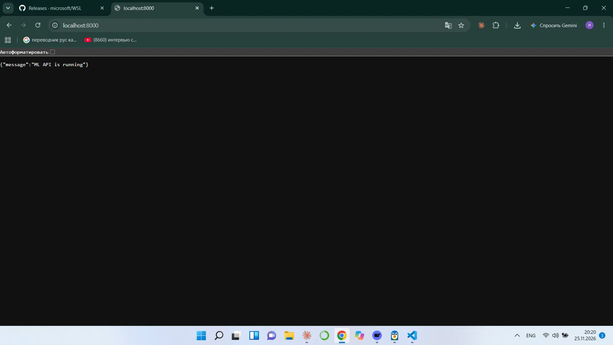
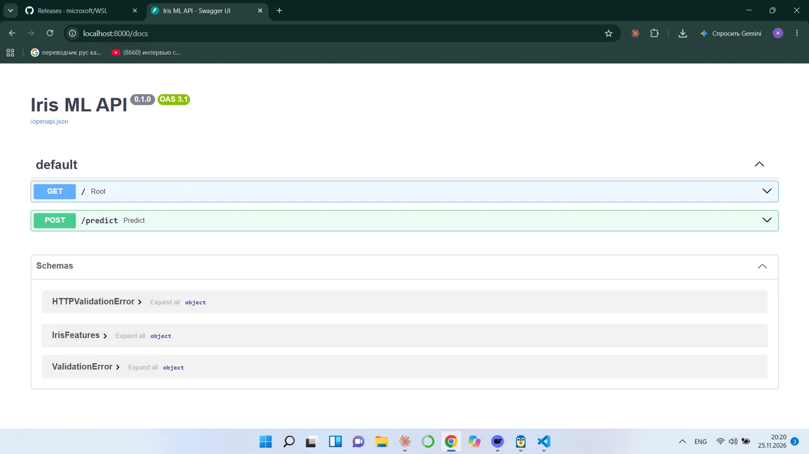
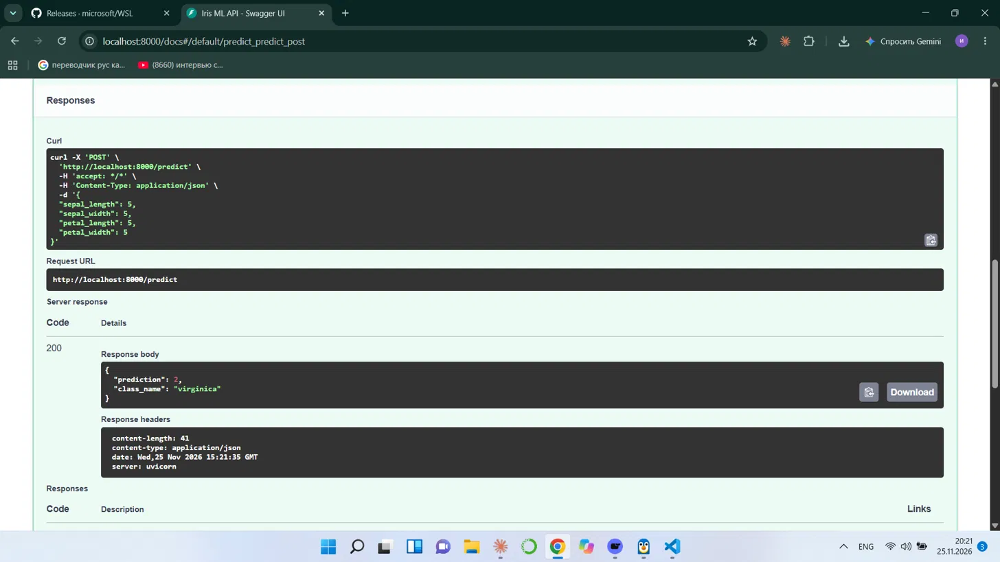

# ML Model Deployment with FastAPI and Docker

A simple machine learning project: a classifier is trained on the classic Iris dataset, saved to a file, and served as a REST API with FastAPI. The API is containerized with Docker, so it runs the same way on any machine.

## Project structure

```
ml-fastapi-docker/
├── main.py            # FastAPI application
├── train.py           # trains and saves the model
├── model.joblib       # saved trained model
├── requirements.txt   # Python dependencies
├── Dockerfile         # container instructions
├── .dockerignore      # files excluded from the Docker image
├── screenshots/       # screenshots of the working API
└── README.md
```

## About the model

- **Dataset:** Iris (`sklearn.datasets.load_iris`), 150 samples, 4 features, 3 classes.
- **Algorithm:** Random Forest Classifier (`n_estimators=100`).
- **Split:** 80% train / 20% test, `random_state=42`.
- **Output:** the trained model is saved as `model.joblib` and loaded by the API at startup.

Input features: `sepal_length`, `sepal_width`, `petal_length`, `petal_width` (in cm).
Classes: `0 = setosa`, `1 = versicolor`, `2 = virginica`.

## API endpoints

| Method | Path       | Description                               |
|--------|------------|-------------------------------------------|
| GET    | `/`        | Health check, confirms the API is running |
| POST   | `/predict` | Returns the predicted Iris class          |
| GET    | `/docs`    | Interactive Swagger documentation         |

### Example request

```bash
curl -X POST http://localhost:8000/predict \
  -H "Content-Type: application/json" \
  -d '{"sepal_length": 5.1, "sepal_width": 3.5, "petal_length": 1.4, "petal_width": 0.2}'
```

### Example response

```json
{
  "prediction": 0,
  "class_name": "setosa"
}
```

## Run locally

1. Create and activate a virtual environment:

   ```bash
   python -m venv venv
   venv\Scripts\activate          # Windows
   source venv/bin/activate       # Linux / macOS
   ```

2. Install dependencies:

   ```bash
   pip install -r requirements.txt
   ```

3. Train the model (creates `model.joblib`):

   ```bash
   python train.py
   ```

4. Start the API:

   ```bash
   uvicorn main:app --reload
   ```

5. Open in the browser:
   - http://127.0.0.1:8000/ : root endpoint
   - http://127.0.0.1:8000/docs : Swagger UI

## Run with Docker

1. Build the image:

   ```bash
   docker build -t ml-fastapi-app .
   ```

2. Run the container and expose port 8000:

   ```bash
   docker run -p 8000:8000 ml-fastapi-app
   ```

3. Open in the browser:
   - http://localhost:8000/ : root endpoint
   - http://localhost:8000/docs : Swagger UI

> The server listens on `0.0.0.0` inside the container. In the browser, use `localhost`, not `0.0.0.0`.

Note: the Python version in the `Dockerfile` (`python:3.14-slim`) matches the version used locally, so the pinned dependencies in `requirements.txt` install without conflicts.

## Screenshots

### Root endpoint (`GET /`)


### Swagger UI (`/docs`)


### Prediction (`POST /predict`)


## Technologies

Python, scikit-learn, joblib, FastAPI, Uvicorn, Docker.
